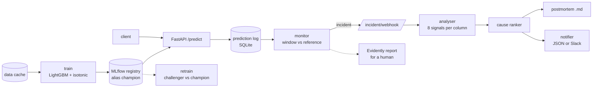

# MLOps Pipeline + Incident Responder

> A credit-default model that is trained, versioned, served and monitored, plus an incident
> responder that says *which column broke and how* when drift fires. The responder's ranking is
> scored on injected faults against the usual "largest PSI feature" reading.

[](https://github.com/Prithv122/mlops-pipeline/actions/workflows/ci.yml)

**Live demo:** not deployed; runs locally (one command to train, one to serve).
**Stack:** Python 3.12 · LightGBM + isotonic calibration · MLflow 3 registry (SQLite) · FastAPI ·
SQLite prediction log · Evidently · DVC · Docker · pytest

---

## 1. The problem

A credit-default model that is trained once and forgotten degrades silently. A drift monitor
helps, but the page it sends usually reads "PSI high on BILL_AMT1", and the on-call engineer
still has to work out whether customers changed or an upstream system broke. Those need
opposite responses: a population shift may call for retraining, a broken feed calls for a fix
upstream and *no* retraining on bad data.

This repo builds the plumbing (versioned training, a served model, a prediction log, drift
monitoring, a manual retrain gate) and then measures the part teams usually guess at: when one
known fault is injected into live-like traffic, does a cause ranker point at the right column,
and name the right kind of fault, more often than reading off the largest PSI?

## 2. The data

| | |
|---|---|
| Source | UCI "Default of Credit Card Clients" (Taiwan, 2005), via the cleaned cache of [fraud-calibrated](https://github.com/Prithv122/fraud-calibrated) |
| Size | 30,000 rows, 23 features, 22.1% defaults |
| Licence | CC BY 4.0 ([UCI dataset 350](https://archive.ics.uci.edu/dataset/350/default+of+credit+card+clients)) |
| Refresh | one-off |

The rows have **no timestamps**. Every evaluation "window" is a seeded random draw of 1,000
rows from the held-out split, with a fault applied to that window. Real traffic has ordering,
seasonality and late labels that this does not reproduce; every responder number below is
conditional on that.

## 3. Architecture



| Component | File | What it does |
|---|---|---|
| Model | `model/` (vendored) | LightGBM with native categoricals, isotonic calibration, expected-cost flag |
| Training + registry | `train.py`, `registry.py` | Fit, log to MLflow, register, move the `champion` alias; retrain promotes a challenger only if AUC ≥ champion − 0.005 and Brier ≤ champion + 0.002 |
| Serving | `serve/` | `POST /predict` (calibrated probability + cost flag + model version), `GET /health`, `GET /model`; every call is logged |
| Monitoring | `monitor/stats.py` | Per column: PSI, KS, null-rate change, out-of-range share, unseen codes, median log-ratio, code-set change, became-constant |
| Responder | `incident/` | No-fault calibration → robust z-scores → evidence per (fault class, column) → ranked, diagnosed causes → postmortem → notification |
| Evaluation | `evaluate.py`, `incident/faults.py` | 240 seeded fault scenarios + 200 controls, ranker vs PSI baseline, paired bootstrap |

## 4. Key decisions & tradeoffs

| Decision | Chose | Over | Why |
|---|---|---|---|
| How the model gets here | Vendor five modules at a pinned commit, hashes in NOTES.md | `uv add` the model repo by git SHA | Survives a history rewrite upstream; the model code is readable in this repo. Checked by result: the same test AUC, Brier and ECE as the source |
| Evaluation design | Pre-registered protocol, thresholds locked before any code, development seeds separate from evaluation seeds, one run | Iterate on the evaluation grid until the ranker looks good | A ranker tuned on the scenarios it is scored on proves nothing. Two amendments were made before the run, each dated, each from development seeds only |
| Primary metric | Column top-1, scored identically for both methods | "Right cause" (class + column) | The PSI baseline never names a fault class, so comparing classes would grant the ranker a free win. Class accuracy is reported separately |
| Scoring signals | Robust z against 200 no-fault windows (median/MAD, floor 0.01, cap 1,000) | Fixed thresholds per signal (PSI > 0.25, KS > 0.1) | Different signals live on different scales; calibrating each on no-fault windows puts them on one scale and sets the incident line τ from data |
| Fault diagnosis | Inside a column, the most specific class above τ wins (null → unit break → recode → shift) | Highest single score wins | PSI and KS rise under every fault, so "shift" otherwise wins by default; measured on development seeds (Amendment 1) |
| Postmortem text | A deterministic template; an optional language-model writer gets only the measured ranking and the table is appended verbatim | Let a model write the diagnosis | Prose can't be scored objectively; numbers must never come from the model |
| Registry backend | MLflow on a local SQLite file, artifacts beside it | An MLflow tracking server | No service to run; the alias/registry API is the same one a server exposes |
| Live verdicts | Only on windows at least as large as the calibration windows | Score any window | Calibrated on 1,000 rows, a 100-row window raised a false incident 100 times in 100 |

## 5. Results

_Filled from the one-time evaluation run (`results/eval/REPORT.md`); nothing here is
interpreted before that report exists._

**Model (from `train`, test fold of 6,000 rows):** AUC 0.7750 · Brier 0.1339 · ECE 0.0237,
identical to the source project's published numbers, which checks the vendoring.

## 6. How to run

```bash
git clone https://github.com/Prithv122/mlops-pipeline.git
cd mlops-pipeline
uv sync --all-groups
uv run pytest
```

Train and register the champion (writes `mlstore/`), then serve it:

```bash
uv run mlops-pipeline train
uv run mlops-pipeline serve --port 8000 --null-model mlstore/null_model.json
```

The first `serve` fits the responder's no-fault calibration (400 windows, about a minute) and
caches it in `mlstore/null_model.json`. Settings come from `MLOPS_*` variables or a `.env`
file (`.env.example` lists them; blanks keep the defaults).

Watch a window of the prediction log and send an alert to the running server:

```bash
uv run mlops-pipeline inject --fault unit_break --severity 1 --seed 10005 --out window.csv
uv run mlops-pipeline monitor --start 2026-10-23T11:00:00 --end 2026-10-23T12:00:00 --webhook http://127.0.0.1:8000/incident/webhook --report-dir mlstore/reports
```

`inject` writes a faulted window (development seeds only); send its rows to `/predict` to see
the loop end to end. Postmortems land in `mlstore/postmortems/`.

Other commands:

| Command | Does |
|---|---|
| `uv run mlops-pipeline retrain` | Train a challenger; promote only by the rule in §3 |
| `uv run mlops-pipeline eval-responder --smoke --out results/smoke` | Development-seed evaluation |
| `uv run mlops-pipeline eval-responder --full --out results/eval` | The pre-registered run (refuses unless the tree is clean, the data hash matches and nothing is there yet) |
| `uv run --group pipeline dvc repro` | `prepare → train → eval_responder_smoke` with caching |
| `docker build -t mlops-pipeline .` | Container image; mount a volume at `/app/mlstore` and run `train` inside it first |

## 7. What I'd change at 100× scale

_To be written with the results._

---

## References

- Siddiqi, N. (2006). *Credit Risk Scorecards.* Wiley. Source of the PSI 0.1 / 0.25 rules of
  thumb used by the baseline.
- Yeh, I-C. & Lien, C-H. (2009). The comparisons of data mining techniques for the predictive
  accuracy of probability of default of credit card clients. *Expert Systems with Applications*
  36(2). The dataset's origin.
