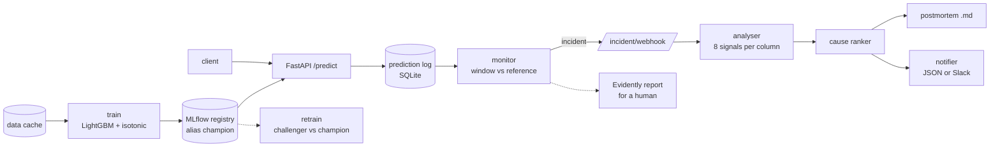

# MLOps Pipeline + Incident Responder

> A credit-default model that is trained, versioned, served and monitored, plus an incident
> responder that says *which column broke and how* when drift fires. The responder's ranking is
> scored on injected faults against the usual "largest PSI feature" reading.

[](https://github.com/Prithv122/mlops-pipeline/actions/workflows/ci.yml)

**Live demo:** not deployed; runs locally (one command to train, one to serve).
**Stack:** Python 3.12 · LightGBM + isotonic calibration · MLflow 3 registry (SQLite) · FastAPI ·
SQLite prediction log · Evidently · DVC · Docker · pytest

---

## 1. The problem

A credit-default model that is trained once and forgotten degrades silently. A drift monitor
helps, but the page it sends usually reads "PSI high on BILL_AMT1", and the on-call engineer
still has to work out whether customers changed or an upstream system broke. Those need
opposite responses: a population shift may call for retraining, a broken feed calls for a fix
upstream and *no* retraining on bad data.

This repo builds the plumbing (versioned training, a served model, a prediction log, drift
monitoring, a manual retrain gate) and then measures the part teams usually guess at: when one
known fault is injected into live-like traffic, does a cause ranker point at the right column,
and name the right kind of fault, more often than reading off the largest PSI?

## 2. The data

| | |
|---|---|
| Source | UCI "Default of Credit Card Clients" (Taiwan, 2005), via the cleaned cache of [fraud-calibrated](https://github.com/Prithv122/fraud-calibrated) |
| Size | 30,000 rows, 23 features, 22.1% defaults |
| Licence | CC BY 4.0 ([UCI dataset 350](https://archive.ics.uci.edu/dataset/350/default+of+credit+card+clients)) |
| Refresh | one-off |

The rows have **no timestamps**. Every evaluation "window" is a seeded random draw of 1,000
rows from the held-out split, with a fault applied to that window. Real traffic has ordering,
seasonality and late labels that this does not reproduce; every responder number below is
conditional on that.

## 3. Architecture



| Component | File | What it does |
|---|---|---|
| Model | `model/` (vendored) | LightGBM with native categoricals, isotonic calibration, expected-cost flag |
| Training + registry | `train.py`, `registry.py` | Fit, log to MLflow, register, move the `champion` alias; retrain promotes a challenger only if AUC ≥ champion − 0.005 and Brier ≤ champion + 0.002 |
| Serving | `serve/` | `POST /predict` (calibrated probability + cost flag + model version), `GET /health`, `GET /model`; every call is logged |
| Monitoring | `monitor/stats.py` | Per column: PSI, KS, null-rate change, out-of-range share, unseen codes, median log-ratio, code-set change, became-constant |
| Responder | `incident/` | No-fault calibration → robust z-scores → evidence per (fault class, column) → ranked, diagnosed causes → postmortem → notification |
| Evaluation | `evaluate.py`, `incident/faults.py` | 240 seeded fault scenarios + 200 controls, ranker vs PSI baseline, paired bootstrap |

## 4. Key decisions & tradeoffs

| Decision | Chose | Over | Why |
|---|---|---|---|
| How the model gets here | Vendor five modules at a pinned commit, hashes in NOTES.md | `uv add` the model repo by git SHA | Survives a history rewrite upstream; the model code is readable in this repo. Checked by result: the same test AUC, Brier and ECE as the source |
| Evaluation design | Pre-registered protocol, thresholds locked before any code, development seeds separate from evaluation seeds, one run | Iterate on the evaluation grid until the ranker looks good | A ranker tuned on the scenarios it is scored on proves nothing. Two amendments were made before the run, each dated, each from development seeds only |
| Primary metric | Column top-1, scored identically for both methods | "Right cause" (class + column) | The PSI baseline never names a fault class, so comparing classes would grant the ranker a free win. Class accuracy is reported separately |
| Scoring signals | Robust z against 200 no-fault windows (median/MAD, floor 0.01, cap 1,000) | Fixed thresholds per signal (PSI > 0.25, KS > 0.1) | Different signals live on different scales; calibrating each on no-fault windows puts them on one scale and sets the incident line τ from data |
| Fault diagnosis | Inside a column, the most specific class above τ wins (null → unit break → recode → shift) | Highest single score wins | PSI and KS rise under every fault, so "shift" otherwise wins by default; measured on development seeds (Amendment 1) |
| Postmortem text | A deterministic template; an optional language-model writer gets only the measured ranking and the table is appended verbatim | Let a model write the diagnosis | Prose can't be scored objectively; numbers must never come from the model |
| Registry backend | MLflow on a local SQLite file, artifacts beside it | An MLflow tracking server | No service to run; the alias/registry API is the same one a server exposes |
| Live verdicts | Only on windows at least as large as the calibration windows | Score any window | The robust z-scores are calibrated on 1,000-row windows; a much smaller window is noisier and false-alarms far more often (seen on development seeds in review). Short windows get the status `insufficient_rows` instead of a verdict |

## 5. Results

**Model (from `train`, test fold of 6,000 rows):** AUC 0.7750 · Brier 0.1339 · ECE 0.0237,
identical to the source project's published numbers, which checks the vendoring.

**Responder: one pre-registered run.** 240 fault windows (4 classes × 3 severities × 20 seeds)
and 200 no-fault windows of 1,000 rows each, drawn from the held-out split. Run once, from a clean
commit (`4d503e3`), on 2026-10-23. Full tables, per-class and per-severity, are in
[`results/eval/REPORT.md`](results/eval/REPORT.md).

| Pre-registered test | Rule | Result | Verdict |
|---|---|---|---|
| **H1**: does the ranker find the broken column more often than "largest PSI"? | gain ≥ 0.15 **and** 95% interval above 0 | 0.792 vs 0.742, gain **+0.050** (0.008 to 0.092) | **Fail** |
| **H2**: false incidents on no-fault windows | ≤ 5% | **1 of 200** (0.5%; Wilson 0.1% to 2.8%) | **Pass** |

H1 fails: the ranker is better than the baseline, but by a third of the pre-registered margin.

| Metric (240 fault windows) | Ranker | PSI baseline | Note |
|---|---|---|---|
| Column top-1 (primary) | 0.792 | 0.742 | scored identically |
| Column MRR | 0.825 | 0.770 | |
| Names the fault type correctly | **0.729** | 0.242 | baseline can only ever say "shift" |
| Raises an incident (detection) | **0.579** | 0.371 | both at ≤ 0.5% false incidents |
| False incidents, 200 controls | 1 (0.5%) | 0 (0%) | |

**Where the difference comes from.** 18 of the ranker's 19 wins are 5% null spikes. PSI cannot
see them: the nulls fall out of every bin and the score barely moves, so the baseline found the
column in 0 of 20 such windows and the ranker in 18. All 7 of its losses are the same mechanism:
a spurious `unit_break` on a column whose median sits on a coarse grid (LIMIT_BAL, PAY_AMT4/6,
BILL_AMT2). The one false incident on a control window is the same thing again (PAY_AMT4). This
weakness was found during development and written into the protocol before the run (Amendment 2,
"heaped medians"). Severity 1 and 2 faults are found by both methods almost every time (ranker
0.762 / 0.988, baseline 0.750 / 1.000). The comparison is decided by the subtle faults.

**Naming the fault, by class:** null spike 0.967, unit break 0.967, shift 0.650, recode 0.333. Shift
diagnosis splits by column. AGE shifts are named correctly from severity 1 up. LIMIT_BAL shifts
are right at severity 0 but only half the time at severity 1 and never at severity 2: the median
moves a grid step and reads as a broken feed. **Recodes** (EDUCATION codes 1↔2 swapped on some
rows) are invisible to both methods until every row is affected, as the protocol predicted.

**Exploratory ablation S1, declared before the run, not a hypothesis test.** The same ranker
without the grid-sensitive `median_log_ratio` signal: column top-1 0.833 (+0.092 vs baseline,
0.058 to 0.129), fault type named 0.829, detection 0.808, false incidents 2 of 200. That one signal
causes most of the misdiagnoses. Even without it, the gain stays below the 0.15 bar, and the frozen
ranker's verdict stands either way. S1 was named after development results had been seen, so it is
reported as a failure mode the experiment found, not as a replacement result.

**What to take from it.** On column-finding alone, a cause ranker adds little over "largest PSI"
when faults are large; its value is in the subtle faults PSI misses (nulls) and in **naming the
kind of fault** (0.73 against a baseline that can only say "shift"), which is what decides between
retraining and fixing a feed. Robust z-scores need care on discrete or heaped columns: a MAD of
zero turns one grid step into an incident.

**Limits.** Windows are random draws, not time slices; one dataset; one fault per window; faults
are synthetic with known causes; label-dependent faults (default-rate shift, concept drift) are
out of scope because labels arrive late in credit.

**What is not verified.** Read these as built and unit-tested, not as working integrations:

- **Docker image:** the `Dockerfile` has never been built or run. Docker was not available on the
  build machine.
- **Slack:** the notifier builds Slack Block Kit payloads and is tested with a fake transport. No
  message has been posted to a real Slack workspace.
- **Language-model postmortem writer:** it is tested with a fake model only. No real model has
  written a postmortem, and its prose is never scored.
- **Retrain workflow:** `retrain.yml` is a manual GitHub workflow; its retrain command is tested
  locally, the workflow itself has not run on GitHub.
- **Not deployed:** the API has run locally, on this machine, only.

## 6. How to run

```bash
git clone https://github.com/Prithv122/mlops-pipeline.git
cd mlops-pipeline
uv sync --all-groups
uv run pytest
```

Train and register the champion (writes `mlstore/`), then serve it:

```bash
uv run mlops-pipeline train
uv run mlops-pipeline serve --port 8000 --null-model mlstore/null_model.json
```

The first `serve` fits the responder's no-fault calibration (400 windows; about a minute on a quiet machine) and
caches it in `mlstore/null_model.json`. Settings come from `MLOPS_*` variables or a `.env`
file (`.env.example` lists them; blanks keep the defaults).

Watch a window of the prediction log and send an alert to the running server:

```bash
uv run mlops-pipeline inject --fault unit_break --severity 1 --seed 10005 --out window.csv
uv run mlops-pipeline monitor --start 2026-10-23T11:00:00 --end 2026-10-23T12:00:00 --webhook http://127.0.0.1:8000/incident/webhook --report-dir mlstore/reports
```

`inject` writes a faulted window (development seeds only); send its rows to `/predict` to see
the loop end to end. Postmortems land in `mlstore/postmortems/`.

Other commands:

| Command | Does |
|---|---|
| `uv run mlops-pipeline retrain` | Train a challenger; promote only by the rule in §3 |
| `uv run mlops-pipeline eval-responder --smoke --out results/smoke` | Development-seed evaluation |
| `uv run mlops-pipeline eval-responder --full --out results/eval` | The pre-registered run (refuses unless the tree is clean, the data hash matches and nothing is there yet) |
| `uv run --group pipeline dvc repro` | `prepare → train → eval_responder_smoke` with caching |
| `docker build -t mlops-pipeline .` | Container image; mount a volume at `/app/mlstore` and run `train` inside it first |

## 7. What I'd change at 100× scale

- **Calibration per column type, not one floor.** The first fix is the one the results point at:
  give discrete or heaped columns a signal that respects their grid (a count of grid steps, or a
  chi-square on the code frequencies) instead of a robust z with a 0.01 floor. That is a new
  pre-registered study, not a patch to this one.
- **Prediction log.** One SQLite file with a row per request stops at a few hundred writes a
  second and one host. At 100× it becomes an append-only event stream (Kafka or Kinesis) landing
  in partitioned Parquet, and the monitor reads windows from the lake on a schedule.
- **Monitoring cost.** Eight statistics × 23 columns per window is trivial here; at thousands of
  features, the responder would screen with cheap signals (null rate, range, counts per code) and
  compute KS and PSI only on the columns that move.
- **Windows in time.** Real windows should be time slices with a minimum row count per slice.
  They also need a no-fault calibration that is refreshed as the population changes, so seasonal
  drift does not page anyone.
- **Registry and serving.** MLflow on SQLite becomes an MLflow server on Postgres with an object
  store for artifacts. The API runs behind a load balancer with the model loaded per replica, and
  promotion moves the alias after a shadow or canary period instead of an offline comparison only.
- **Labels.** Join late-arriving default labels back to the log to watch performance, not just
  inputs. That covers the blind spot this responder admits.

---

## References

- Siddiqi, N. (2006). *Credit Risk Scorecards.* Wiley. Source of the PSI 0.1 / 0.25 rules of
  thumb used by the baseline.
- Yeh, I-C. & Lien, C-H. (2009). The comparisons of data mining techniques for the predictive
  accuracy of probability of default of credit card clients. *Expert Systems with Applications*
  36(2). The dataset's origin.
